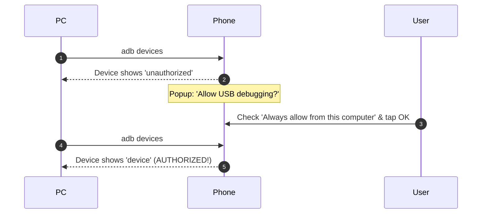

# 🔌 Zero-to-Appliance: The Complete "From Scratch" Guide

> **Never used ADB or developer mode before?**
> This guide walks you through every single step to resurrect any old Android phone pulled from a drawer, from total zero to a working dedicated hardware appliance.

---

## 📋 What You Need
1. An old Android phone (Android 4.4 KitKat up to Android 10+).
2. A USB cable (Micro-USB or USB-C, ensuring it supports **data transfer**, not just charging).
3. A Windows PC, Mac, or Linux machine.
4. 5 minutes of time.

---

## 🛠️ Step 0: The Fresh Start (Factory Reset & Setup Bypass)

If the phone has been sitting in a drawer with old PINs, apps, or accounts:

1. **Perform a Clean Factory Reset**:
   - Go to **Settings ➔ Backup & Reset ➔ Factory Data Reset** (or **Settings ➔ System ➔ Reset Options**).
   - Tap **Erase Everything / Reset Phone**.
2. **Bypass the Setup Wizard**:
   - When the phone reboots to the initial setup screen ("Welcome / Start"):
   - **Do NOT insert a SIM card** (tap "Skip").
   - **Do NOT sign into a Google Account** (tap "Skip" / "Skip Anyway").
   - **Do NOT set up a lock screen PIN or fingerprint** (tap "Skip").
   - Connect to your local Wi-Fi network (needed if you want to use NewPipe or FM streaming).

---

## 🔓 Step 1: Enable Developer Options (The "7-Tap" Secret)

Android hides Developer Options by default on all devices. To reveal it:

```
Settings ➔ About Phone ➔ Tap "Build Number" 7 times
```


### Brand-Specific Variations:
* **Motorola / Stock Android / Pixel / Nexus**: 
  `Settings ➔ About phone ➔ Scroll down to "Build number" ➔ Tap 7 times`.
* **Samsung Galaxy**: 
  `Settings ➔ About phone ➔ Software information ➔ Tap "Build number" 7 times`.
* **Xiaomi / Redmi (MIUI)**: 
  `Settings ➔ About phone ➔ Tap "MIUI version" 7 times`.
* **LG**: 
  `Settings ➔ About phone ➔ Software info ➔ Tap "Build number" 7 times`.
* **OnePlus / Realme / Oppo**: 
  `Settings ➔ About device ➔ Version ➔ Tap "Build number" 7 times`.

> **Verification:** A toast notification will pop up on screen: **"You are now a developer!"**

---

## 🔌 Step 2: Enable USB Debugging

Now that Developer Options is unlocked:

1. Go back to the main **Settings** screen.
2. Scroll to the bottom and tap **Developer Options** (on newer Android versions, it may be under **Settings ➔ System ➔ Advanced ➔ Developer options**).
3. Toggle the switch at the top to **ON**.
4. Scroll down to the **Debugging** section.
5. Toggle **USB Debugging** to **ON**.
6. When the confirmation prompt appears (*"Allow USB debugging?"*), tap **OK**.

---

## 💻 Step 3: Install ADB on Your Computer (In 10 Seconds)

You do **NOT** need to install heavy IDEs or the full Android Studio (which is 2GB+). You only need the 4MB ADB CLI:

### On Windows (Run in PowerShell):
```powershell
# Using Windows Package Manager (Built into Windows 10 & 11)
winget install Google.PlatformTools
```
*Or download standalone [Google Platform Tools ZIP](https://developer.android.com/tools/releases/platform-tools), unzip, and add to your PATH.*

### On macOS (Terminal):
```bash
brew install android-platform-tools
```

### On Linux (Ubuntu / Debian / Raspberry Pi):
```bash
sudo apt update && sudo apt install adb
```

---

## 🤝 Step 4: Connect USB & Authorize Your Computer (Crucial Step!)

1. Connect the phone to your computer using a USB cable.
2. On your computer, open a terminal (PowerShell or Command Prompt) and run:
   ```bash
   adb devices
   ```
3. **LOOK AT YOUR PHONE SCREEN NOW!**
   A security popup will appear:
   
   > **"Allow USB debugging?"**
   > The computer's RSA key fingerprint is: `XX:XX:XX:...`
   
4. **CRITICAL:** Check the checkbox: **☑ "Always allow from this computer"**, then tap **OK**.



5. Run `adb devices` again. You should see your device serial number followed by `device`:
   ```
   List of devices attached
   TA0050DIGB    device
   ```
   *(If it says `device`, you are 100% ready to resurrect!)*

---

## ⚠️ Troubleshooting USB Connection

| Problem | Cause | Solution |
|---|---|---|
| `adb devices` shows nothing (empty list) | Cable is charge-only or missing driver | 1. Try a different USB cable (must support data).<br>2. Try a different USB port (avoid USB hubs).<br>3. Change USB mode on phone from "Charging" to "MTP / File Transfer". |
| `adb devices` shows `unauthorized` | Computer RSA key not accepted | Look at the phone screen, unlock it, and tap "OK" on the "Allow USB debugging" prompt. |
| Windows Device Manager shows yellow `!` on Android | Missing Windows USB driver | Download the official OEM USB driver (e.g. [Motorola Device Manager](https://motorola-global-portal.custhelp.com/app/answers/detail/a_id/88481) or [Google USB Driver](https://developer.android.com/studio/run/win-usb)). |

---

## 🚀 Step 5: Run the 1-Click Turnkey Provisioner

Once authorized, open PowerShell in this repository folder and run:

```powershell
# 1. Clone repository
git clone https://github.com/SGajjar24/resurrect-phone.git
cd resurrect-phone

# 2. Run automated turnkey appliance setup
powershell -ExecutionPolicy Bypass -File scripts/setup_appliance.ps1
```

### What This Script Does Automatically:
1. Verifies the device density is safe (prevents the `density=0` SystemUI crash).
2. Debloats 20+ carrier and Google telemetry packages for user 0.
3. Sets up power policies (screen stays awake when on a charging stand).
4. Enables Immersive Sticky Kiosk mode (hides navigation bar and status bar).
5. Installs the zero-dependency `BhaktiPlayer.apk` appliance.
6. Launches the sacred UI immediately.

---

## 🛕 Step 6: Set as Permanent Home Launcher

1. Press the **Home** hardware or on-screen button on the phone.
2. A prompt will appear: **"Complete action using"**:
   - Select **શ્રી ભક્તિ સંગ્રહ (BhaktiPlayer)**.
   - Tap **"ALWAYS"**.
3. Now, even if the user restarts the phone or touches any button, it will **never leave the devotional player**.

---

## 🎵 Step 7: Adding / Customizing Audio Tracks

The appliance is pre-configured for 7 sacred Gujarati & Sanskrit prayers:
* `Hanuman_Chalisa.m4a`
* `Ganesh_Aarti.m4a`
* `Shiv_Aarti.m4a`
* `Krishna_Bhajan.m4a`
* `Amba_Ma_Aarti.m4a`
* `Dada_Bhagwan_Aarti.m4a`
* `Jagdish_Aarti.m4a`

To push your own audio files directly into the phone:
```bash
# Push an entire folder of songs to the phone
adb push "C:\path\to\MyBhajans" /sdcard/Bhajans/
```
*(The player automatically scans `/sdcard/Bhajans/` for `.m4a`, `.mp3`, `.ogg`, and `.wav` files!)*

---

*Congratulations! Your 10-year-old phone is now an elegant, dedicated hardware appliance.*
